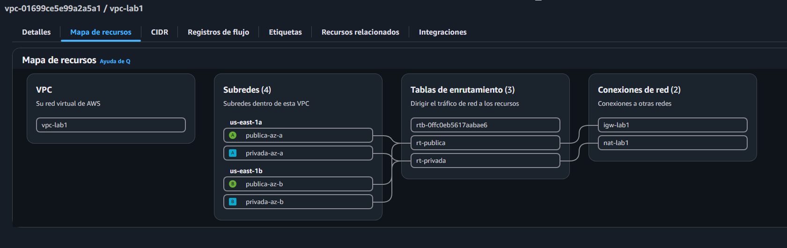
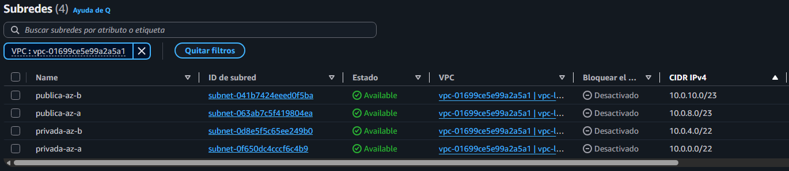
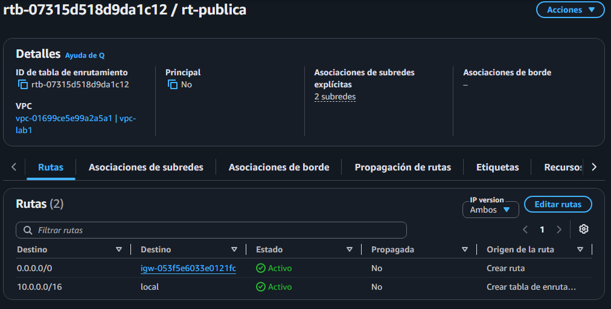
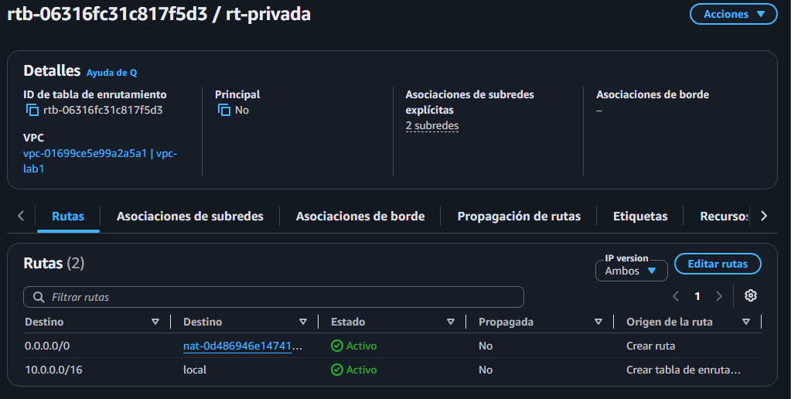

# Redes Lab 1 - VPC con subnets públicas y privadas

## Objetivo
Construir en AWS una VPC (red virtual privada) con dos tipos de subnets, públicas y privadas, repartidas en dos zonas de disponibilidad. Las públicas tienen salida directa a internet a través de un Internet Gateway. Las privadas no son alcanzables desde afuera y solo salen a internet a través de un NAT Gateway, de modo que los recursos que no deben estar expuestos se ubican ahí.

## Arquitectura

| Recurso | Nombre | Zona | Detalle |
|---|---|---|---|
| VPC | vpc-lab1 | región us-east-1 | 10.0.0.0/16 |
| Subnet pública | publica-az-a | us-east-1a | 10.0.8.0/23 |
| Subnet pública | publica-az-b | us-east-1b | 10.0.10.0/23 |
| Subnet privada | privada-az-a | us-east-1a | 10.0.0.0/22 |
| Subnet privada | privada-az-b | us-east-1b | 10.0.4.0/22 |
| Internet Gateway | igw-lab1 | - | asociado a vpc-lab1 |
| NAT Gateway | nat-lab1 | us-east-1a (en publica-az-a) | conectividad pública con IP elástica; eliminado al terminar el lab |
| Tabla de enrutamiento | rt-publica | - | asociada a las dos subnets públicas |
| Tabla de enrutamiento | rt-privada | - | asociada a las dos subnets privadas |

El direccionamiento sale del esquema 4 del proyecto de subnetting de Redes M1.

Dato extra: AWS reserva 5 direcciones por subnet (las primeras 4 y la última), por lo que una /23 ofrece 507 hosts usables y una /22, 1019, en vez de los 510 y 1022 del cálculo teórico.

## Cómo funciona

- **VPC:** es la red propia y aislada dentro de AWS. Se usó el rango privado 10.0.0.0/16 (65.536 direcciones), que no se pisa con el 172.31.0.0/16 de la VPC predeterminada.
- **Subnets:** dividen la VPC en sectores. Hay una pública y una privada en cada una de las dos zonas de disponibilidad, para que si una zona falla, la otra siga funcionando con su par completo.
- **Internet Gateway:** es la puerta de la VPC hacia internet. Por sí sola no abre nada: hace falta una ruta que la use.
- **Tablas de enrutamiento:** son las reglas que dicen por dónde sale el tráfico. Una subnet es pública porque su tabla tiene una ruta hacia el Internet Gateway, no por el nombre que lleve.
- **NAT Gateway:** vive en una subnet pública y permite que las subnets privadas inicien conexiones hacia internet (por ejemplo, para descargar actualizaciones), sin que desde internet se pueda iniciar una conexión hacia ellas.

**Rutas de rt-publica** (asociada a publica-az-a y publica-az-b):

| Destino | Objetivo |
|---|---|
| 10.0.0.0/16 | local |
| 0.0.0.0/0 | igw-lab1 |

**Rutas de rt-privada** (asociada a privada-az-a y privada-az-b):

| Destino | Objetivo |
|---|---|
| 10.0.0.0/16 | local |
| 0.0.0.0/0 | nat-lab1 |

La ruta `local` es la que permite que todas las subnets se comuniquen entre sí dentro de la VPC. La ruta `0.0.0.0/0` significa "cualquier destino fuera de la VPC", es decir, internet.

## Evidencia

Mapa de recursos de la VPC, con las subnets por zona y las dos salidas:

Subnets de vpc-lab1 con su bloque CIDR:

Ruta de rt-publica hacia el Internet Gateway:

Ruta de rt-privada hacia el NAT Gateway:

## Costos y limpieza

- La VPC, las subnets, las tablas de enrutamiento y el Internet Gateway no tienen costo.
- El NAT Gateway se cobra por hora (US$0,045 en us-east-1), y su IP elástica US$0,005 por hora. Las horas parciales se facturan como horas completas.
- Se creó, se verificó y se eliminó en la misma sesión, y se liberó la IP elástica. Costo estimado: unos US$0,05.
- Al eliminar el NAT Gateway, la ruta 0.0.0.0/0 de rt-privada queda en estado "agujero negro", sin costo. Si se necesita salida a internet desde las privadas, se vuelve a crear el NAT y se reapunta la ruta.