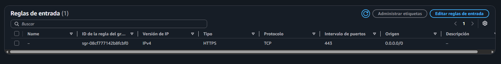
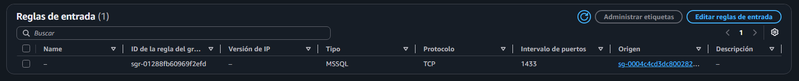
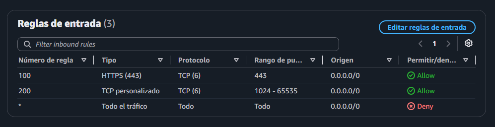
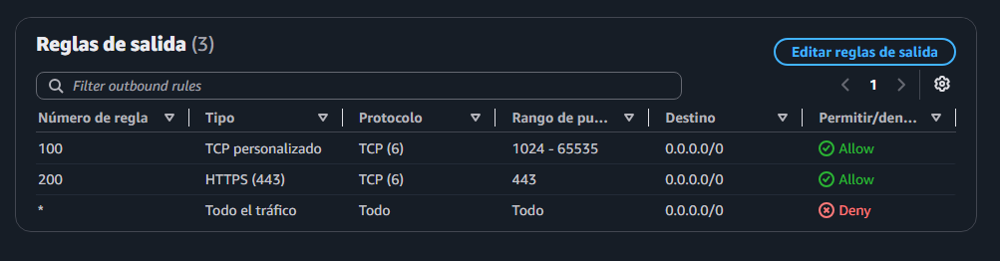
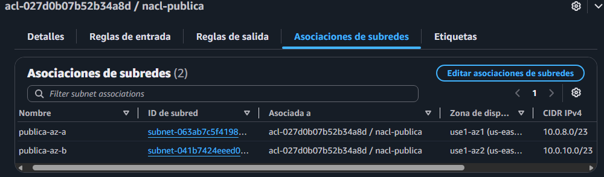

# Redes Lab 2 - Security Groups y NACLs

## Objetivo
Configurar en AWS Security Groups (firewall por recurso, que recuerda las conexiones) y una NACL (firewall por subnet, que no las recuerda) sobre la VPC del Lab 1, para aplicar las reglas de firewall diseñadas en Redes M3 y comprobar en la práctica la diferencia entre ambas capas.

## Arquitectura

### Security Groups

| Nombre | Protege | Regla de entrada | Origen |
|---|---|---|---|
| web-sg | Sitio web | HTTPS (443/TCP) | 0.0.0.0/0 (cualquier IP) |
| db-sg | Base de datos | MSSQL (1433/TCP) | web-sg (solo el grupo del sitio web) |

Las reglas de salida de ambos grupos quedaron con el valor por defecto (todo permitido).

### NACL nacl-publica

Asociada a las subnets publica-az-a y publica-az-b.

| Dirección | Nº | Protocolo / puertos | Origen / destino | Acción |
|---|---|---|---|---|
| Entrada | 100 | TCP 443 | 0.0.0.0/0 | Permitir |
| Entrada | 200 | TCP 1024-65535 | 0.0.0.0/0 | Permitir |
| Entrada | * | Todo | 0.0.0.0/0 | Denegar |
| Salida | 100 | TCP 1024-65535 | 0.0.0.0/0 | Permitir |
| Salida | 200 | TCP 443 | 0.0.0.0/0 | Permitir |
| Salida | * | Todo | 0.0.0.0/0 | Denegar |

## Cómo funciona

Un Security Group es **stateful**: recuerda las conexiones que pasan. Una NACL es **stateless**: no tiene memoria sobre la conexión y evalúa cada paquete como si fuera la primera vez que lo ve.

| | Security Group | NACL |
|---|---|---|
| Dónde actúa | En cada recurso | En la subnet entera |
| Memoria | Stateful | Stateless |
| Tipo de reglas | Solo permitir | Permitir y denegar |
| Evaluación | Se consideran todas las reglas | Por número, de menor a mayor; gana la primera que coincide |
| Respuestas | Salen solas | Necesitan una regla propia |

Dos casos que lo muestran en este lab:

- **La respuesta necesita su propia regla en la NACL.** Permitir la entrada por el 443 no alcanza: el cliente abre su conexión desde un puerto efímero y la respuesta vuelve a ese puerto, así que hizo falta una regla de salida para el rango 1024-65535.
- **Un grupo de seguridad como origen.** En db-sg el origen es web-sg y no una IP, así que solo los recursos que tengan web-sg pueden hablarle a la base por el 1433. Si se compromete otro equipo de la VPC con otro grupo, no puede llegar a la base, lo que limita el movimiento lateral.

Relación con Redes M3: las reglas 1 y 2 del diseño se aplicaron en web-sg y db-sg. El deny all de la regla 7 corresponde al denegar implícito de los Security Groups y a la regla * de la NACL.

## Alcance y costos

- No se lanzaron instancias EC2: las reglas se configuraron y revisaron en la consola, pero no se probaron con tráfico real.
- Los Security Groups y las NACLs no tienen costo.

## Observación final

Lo que más me costó de este lab fueron las cuestiones técnicas, aunque ahora que lo vi completo parece más simple. Lo que más me sorprendió es la simpleza y la lógica con la que Cloud permite armar este tipo de seguridades: por ejemplo, usar un grupo de seguridad como origen de otro, en lugar de depender de direcciones IP.

Con este lab pasé del diseño de reglas de firewall de Redes M3 a aplicarlo en AWS, y entendí en la práctica la diferencia entre un Security Group (stateful) y una NACL (stateless), y por qué conviene usar las dos capas juntas.