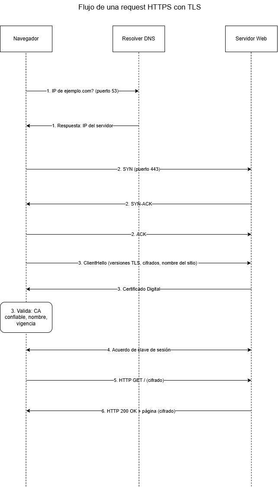

# Redes M2 - Flujo de establecimiento de una conexión HTTPS: DNS, TCP y TLS

## Objetivo
Describir y comprender el proceso de comunicación entre un navegador y un servidor web mediante HTTPS, desde la resolución del nombre de dominio (DNS) y el establecimiento de la conexión TCP hasta la negociación TLS, la validación del certificado digital y el intercambio seguro de solicitudes y respuestas HTTP.

## Pasos
1. **Resolución DNS:** el navegador consulta al resolver DNS (puerto 53) y recibe la IP de ejemplo.com.
2. **Handshake TCP (puerto 443):** SYN, SYN-ACK y ACK. La conexión queda establecida.
3. **Handshake TLS:**
   - **ClientHello:** el navegador envía las versiones de TLS y los cifrados que soporta, y el nombre del sitio.
   - **Certificado:** el servidor responde con su certificado digital.
   - **Validación:** el navegador verifica que lo firmó una CA confiable, que el nombre coincide y que no está vencido ni revocado.
4. **Acuerdo de clave de sesión:** a partir de acá, todo lo que viaja va cifrado.
5. **Request HTTP (cifrada):** `GET /` al servidor, por el puerto 443.
6. **Response HTTP (cifrada):** `200 OK` más el contenido de la página. El navegador la muestra.

## Diagrama

## Observación Final
Este proyecto me permitió comprender que una conexión HTTPS no se establece en un único paso, sino mediante una secuencia de procesos que dependen unos de otros. Uno de los aspectos que más me ayudó a aclarar fue la diferencia entre el certificado digital y la Autoridad Certificadora (CA), entendiendo que el certificado identifica al servidor, la CA lo firma al emitirlo y el navegador verifica esa firma con las CAs en las que ya confía.

También pude relacionar estos conceptos con situaciones prácticas que encontraré al trabajar con infraestructura y servicios en AWS.

